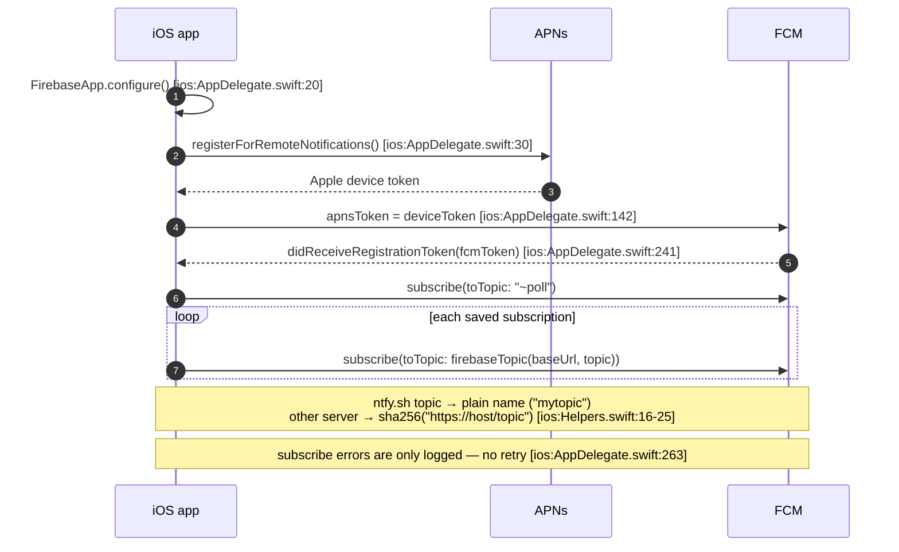
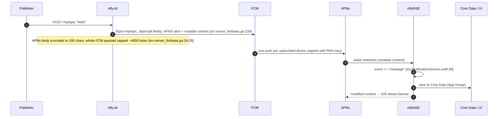
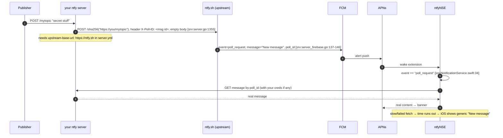
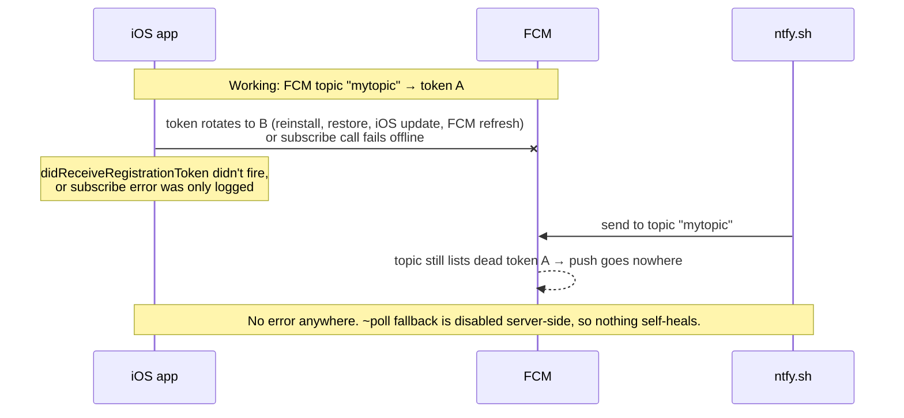

# ntfy iOS — how a notification gets to an iPhone

Reference for working on `binwiederhier/ntfy-ios`. Verified against the code on 2026-11-20:
ntfy-ios `main` and ntfy server `a098f52` (2026-11-16).

**Source tags:** `[ios:file:line]` = ntfy-ios code, `[srv:file:line]` = ntfy server code, `[roadmap]` = Phil's
plan in [ntfy#1680](https://github.com/binwiederhier/ntfy/issues/1680), `[Qn]` = open question, see
[open-questions.md](open-questions.md).

## The cast

| Actor | Knows | Doesn't know |
|---|---|---|
| **Publisher** (curl, scripts, cron jobs) | topic URL | anything about phones |
| **ntfy server** (ntfy.sh, or self-hosted) | topics, messages | which devices listen — it only says "send to FCM topic X" |
| **FCM** (Firebase Cloud Messaging, Google) | FCM topic → device tokens, FCM token → Apple token | message meaning |
| **APNs** (Apple Push Notification service) | Apple device tokens only | topics — Apple has no topic concept |
| **iOS app** (`ntfy` target) | your subscriptions (Core Data), polling, UI | — |
| **NSE** (`ntfyNSE`, Notification Service Extension) | separate process iOS wakes for *alert* pushes; shares Core Data via App Group; ~25–30 s budget `[roadmap]` | — |

Phil's Apple push key (`.p8`) is uploaded to his Firebase project. That's what lets FCM call APNs for the app
`io.heckel.ntfy`. No key, no delivery.

## 1. Registration and topic subscription

Today the app (re)subscribes **only** inside `didReceiveRegistrationToken`. Open PR
[#53](https://github.com/binwiederhier/ntfy-ios/pull/53) says that callback doesn't fire reliably and adds a
reconcile step on launch, after APNs registration, and on every app activation.

## 2. Message on ntfy.sh (the app's home server) — content rides the push

If the topic is **not anonymously readable** (protected topic), the server swaps the message for a
`poll_request` with no content, and the app fetches it with credentials [srv:server_firebase.go:166].

## 3. Message on a self-hosted server — only a "go fetch" signal rides the push

Google and ntfy.sh only ever see a hash and a message ID — never your server, topic name, or content.

## 4. Silent pushes (no banner, no NSE)

Some events are sent as **background** pushes (`content-available`, `apns-push-type: background`)
[srv:server_firebase.go:263]. iOS does **not** run the NSE for these; they go to the app's
`didReceiveRemoteNotification` [ios:AppDelegate.swift:97], and iOS may throttle or drop them ([Q1](open-questions.md#q1--ios-and-silent-pushes)).

| Event | Push type | What the app does |
|---|---|---|
| `message` | alert | NSE saves + displays |
| `poll_request` | alert | NSE fetches from the server, then saves + displays |
| `message_delete`, `message_clear` | **silent** [srv:server_firebase.go:147] | `didReceiveRemoteNotification` exits early unless topic is `~poll` → **ignored**. Later polling stores the event as a message row → blank row ([#1945](https://github.com/binwiederhier/ntfy/issues/1945)) |
| `keepalive` on `~poll` | silent | would poll every subscription — but **the server never sends it**: disabled for a thundering-herd problem [srv:server.go:2270] |

## 5. Where the "forgets its subscription" bug sits (#1305)

Candidate causes (from the code — none proven yet):
1. The re-subscribe callback not firing when needed (PR #53's claim, [Q3](open-questions.md#q3--when-the-token-callback-fires)).
2. A `subscribe(toTopic:)` failing (offline at launch, FCM hiccup) and never retried [ios:AppDelegate.swift:263].
3. FCM dropping topic membership on its side ([Q2](open-questions.md#q2--fcm-losing-topic-membership)).

No server-side safety net: the `~poll` keepalive that would mask all three is off.

## Payload size limits

- APNs rejects payloads over 4 KB — silently, the push never arrives (server comment) [srv:server_firebase.go:282-287].
- Server caps the FCM JSON at 4000 bytes and truncates `message`, setting `truncated=1` [srv:server_firebase.go:220].

## Project conventions (Phil's roadmap, [ntfy#1680](https://github.com/binwiederhier/ntfy/issues/1680))

- **One commit/PR per feature.** Not one giant change.
- **Update `docs/FEATURE_PARITY.md`** as features land. It was last updated 2023-05-23 and is stale: attachments
  and actions are marked incomplete but exist now.
- **Core Data changes need a new model version** in Xcode (lightweight migration). The NSE reads the same store
  through App Group `group.io.heckel.ntfy`, so a bad migration breaks notifications too.
- **Deployment target iOS 16+**, remove old `if #available` guards. The project file disagrees, see
  [Q15](open-questions.md#q15--deployment-target).
- **Critical Alerts entitlement** is already approved on Phil's team.
- **Out of scope:** Apple Watch, custom sounds, `ntfy://` deep links, share extension, self-signed certs,
  notification icons, MDM profiles, editing notifications ([Q17](open-questions.md#q17--out-of-scope-prs)).

## See also

- [debugging.md](debugging.md) — logs, attaching to the NSE, bug leads
- [simulating.md](simulating.md) — fake pushes, your own server and Firebase, what's free
- [open-questions.md](open-questions.md) — unverified claims and how to settle them
- Phil's blog on the iOS architecture: https://blog.ntfy.sh/2023/12/06/138-lines-of-code/#ios-app
